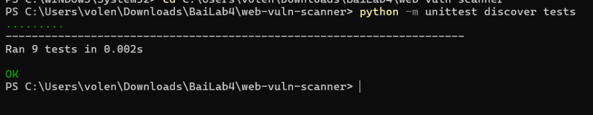
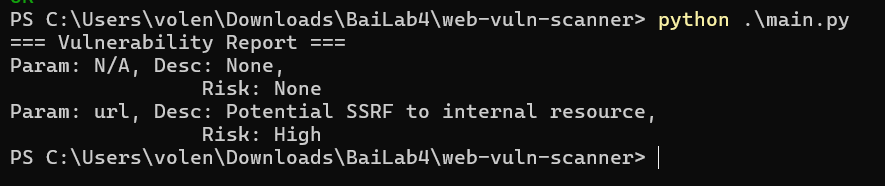
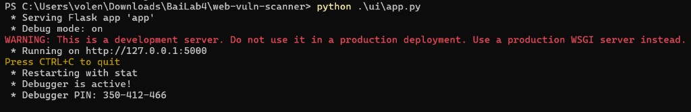
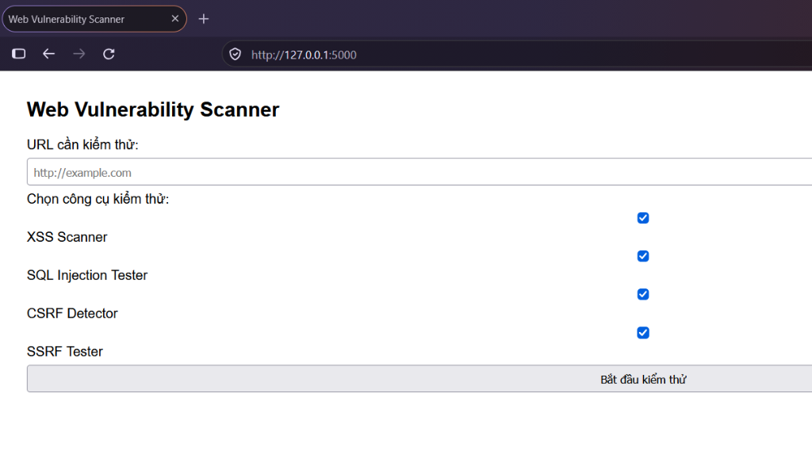
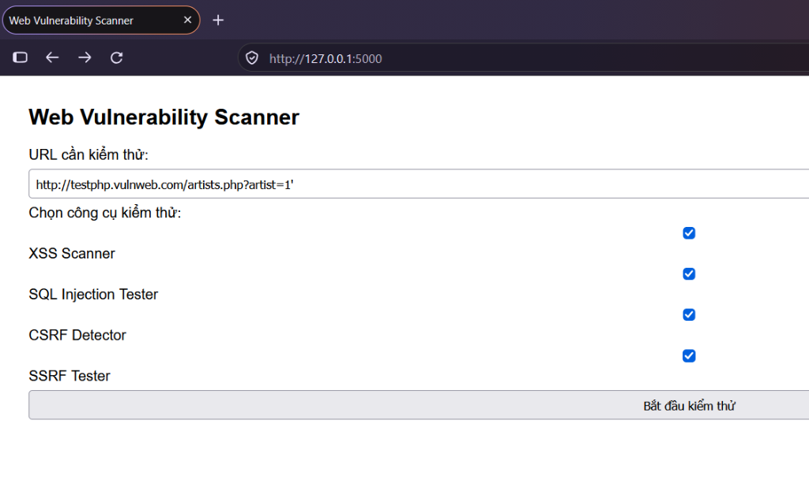
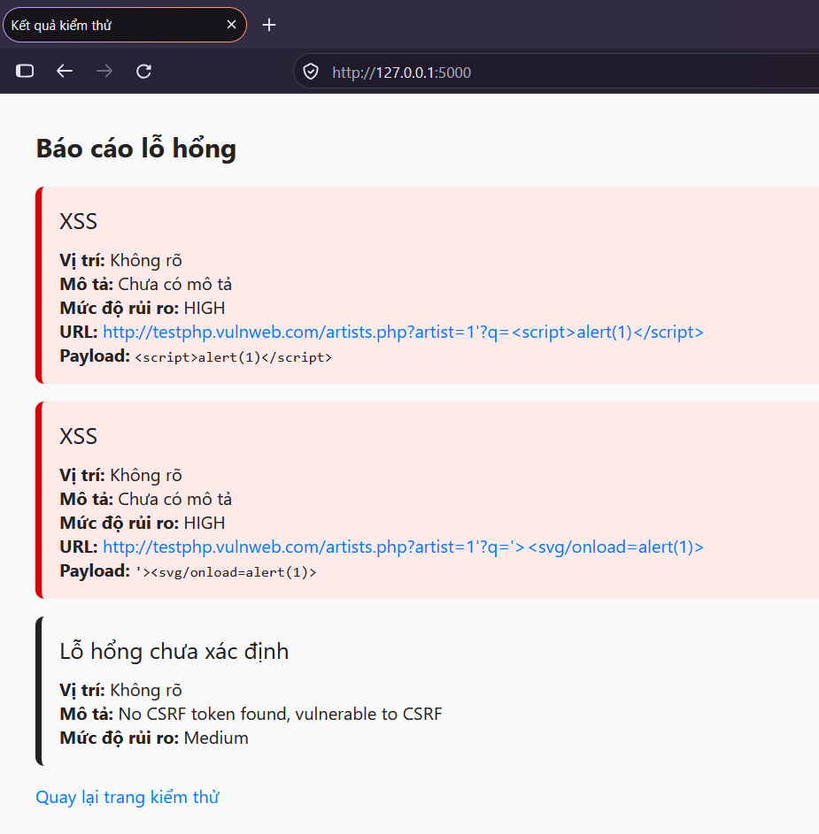
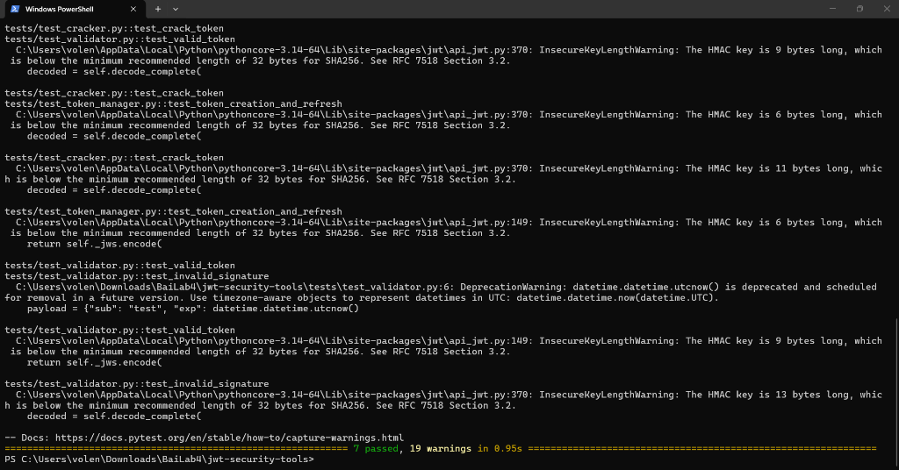
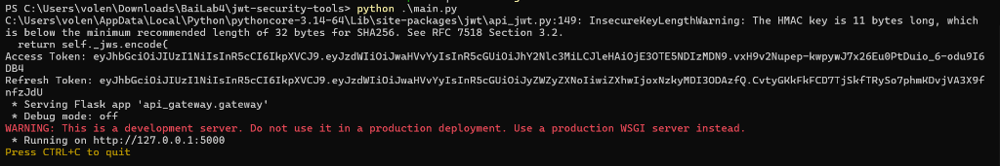
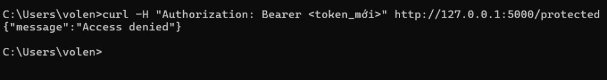
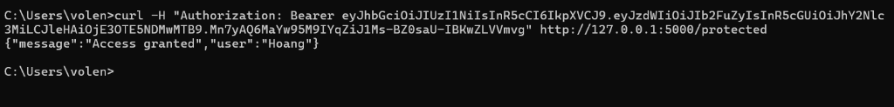

### Họ và Tên: Võ Lê Nhật Hoàng
### MSSV: 2387700017
### Lớp: 23DATA1
# BÀI 4: BẢO MẬT WEB APP VÀ API (WEB VULNERABILITY SCANNER & JWT SECURITY)

---

## 1. Giới thiệu chung
Bài thực hành số 4 tập trung vào việc nhận diện, kiểm thử và xây dựng các cơ chế bảo vệ ứng dụng Web và API thông qua hai chủ đề chính:

1. **Phần 1 – Công cụ quét lỗ hổng Web ([`web-vuln-scanner/`](./web-vuln-scanner/README.md))**:
   - Phát hiện các lỗ hổng bảo mật phổ biến trong OWASP Top 10:
     - **Cross-Site Scripting (XSS)**: Quét và phát hiện Reflected XSS thông qua thư viện payload chuẩn hóa (`<script>alert(1)</script>`, `'><svg/onload=alert(1)>`).
     - **SQL Injection (SQLi)**: Phân tích tham số truy vấn URL để phát hiện các biến thể tấn công (`' OR '1'='1`, `UNION SELECT`,...).
     - **Cross-Site Request Forgery (CSRF)**: Phân tích mã nguồn HTML biểu mẫu để kiểm tra sự hiện diện của CSRF token (`csrf_token`, `_csrf`, `csrfmiddlewaretoken`).
     - **Server-Side Request Forgery (SSRF)**: Kiểm tra các tham số URL có nguy cơ trỏ tới địa chỉ IP cục bộ/nội bộ (`127.0.0.1`, `localhost`, `10.x.x.x`, `192.168.x.x`, `172.16-31.x.x`).
   - Tổng hợp và kết xuất báo cáo lỗ hổng (`ReportGenerator`) với mô tả, vị trí và cấp độ rủi ro (Critical, High, Medium, Low).
   - Triển khai giao diện Web trực quan bằng **Flask** và template **Jinja2**.

2. **Phần 2 – Bộ công cụ bảo mật JWT & API Gateway ([`jwt-security-tools/`](./jwt-security-tools/README.md))**:
   - Phân tích và quản lý vòng đời JSON Web Token (**JWT**):
     - **APIGateway**: Xây dựng cổng API bảo vệ endpoint `/protected` bằng JWT Bearer Token.
     - **JWTCracker**: Thử nghiệm tấn công brute-force từ điển để dò tìm khóa bí mật (secret key) yếu dùng ký JWT bằng mô hình đa luồng (`ThreadPoolExecutor`).
     - **JWTValidator**: Kiểm tra tính toàn vẹn chữ ký và thời hạn hiệu lực của token, xử lý các ngoại lệ `ExpiredSignatureError`, `InvalidSignatureError`.
     - **OAuthClient**: Triển khai Client tuân thủ luồng cấp quyền Authorization Code Flow chuẩn OAuth 2.0.
     - **TokenManager**: Quản lý vòng đời token, tự động phát hành Access Token và cấp lại token mới bằng Refresh Token.

---

## 2. Cấu trúc tổng thể Bài 4
```text
Bài 4/
├── web-vuln-scanner/            # Phần 1: Web Vulnerability Scanner
│   ├── images/                  # Hình ảnh thực nghiệm của Phần 1
│   ├── scanners/                # Các module scanner (CSRF, SQLi, SSRF, XSS)
│   ├── report/                  # Module tạo báo cáo lỗ hổng
│   ├── tests/                   # Bộ kiểm thử Unit Test cho từng module
│   ├── ui/                      # Giao diện Web Flask
│   ├── main.py                  # Điểm khởi chạy quét thử nghiệm qua CLI
│   ├── requirements.txt         # Thư viện phụ thuộc (Flask, requests)
│   ├── __init__.py
│   └── README.md                # Báo cáo chi tiết Phần 1
├── jwt-security-tools/          # Phần 2: JWT Security Tools & API Gateway
│   ├── images/                  # Hình ảnh thực nghiệm của Phần 2
│   ├── api_gateway/             # Module API Gateway bảo vệ endpoint
│   ├── jwt_cracker/             # Module Brute-force khóa bí mật JWT
│   ├── jwt_validator/           # Module thẩm định chữ ký và hạn dùng JWT
│   ├── oauth_client/            # Module OAuth 2.0 Client
│   ├── token_manager/           # Module quản lý vòng đời Access & Refresh Token
│   ├── tests/                   # Bộ kiểm thử tự động với Pytest
│   ├── main.py                  # Khởi chạy API Gateway & phát hành Token cho user "Hoang"
│   ├── pytest.ini               # Cấu hình Pytest pythonpath
│   ├── requirements.txt         # Thư viện phụ thuộc (PyJWT, requests, flask, pytest)
│   └── README.md                # Báo cáo chi tiết Phần 2
└── README.md                    # Tài liệu tổng quan Bài 4
```

---

## 3. Hình ảnh kết quả thực nghiệm

### 3.1. Phần 1: Web Vulnerability Scanner (`web-vuln-scanner`)

#### Chạy kiểm thử tự động Unit Test (`python -m unittest discover tests`):
Toàn bộ 9/9 test case của các module quét lỗ hổng đều vượt qua thành công:


#### Chạy kiểm tra chương trình chính dòng lệnh (`python .\main.py`):


#### Khởi chạy máy chủ Web UI Flask (`python .\ui\app.py` tại `http://127.0.0.1:5000`):


#### Giao diện trang chủ Web Vulnerability Scanner trên trình duyệt:


#### Nhập URL mục tiêu kiểm thử `http://testphp.vulnweb.com/artists.php?artist=1'`:


#### Kết quả báo cáo lỗ hổng phát hiện Reflected XSS (HIGH) và thiếu CSRF Token (Medium):


---

### 3.2. Phần 2: Bảo mật JWT & API Gateway (`jwt-security-tools`)

#### Chạy bộ kiểm thử tự động với Pytest (`pytest tests/`):
Toàn bộ 7/7 test cases (xác thực token, brute force cracker, luồng oauth, refresh token, api gateway) đều đạt `PASSED`:


#### Khởi chạy API Gateway và tự động phát hành Token cho user `Hoang` (`python .\main.py`):


#### Kiểm thử bảo mật: Yêu cầu bị từ chối (`401 Access denied`) khi gửi Token không hợp lệ:


#### Xác thực thành công: Gửi kèm JWT Bearer Token hợp lệ đến `/protected`, phản hồi đúng `user: "Hoang"`:


---

## 4. Hướng dẫn cài đặt và chạy thử nghiệm

### Chạy Web Vulnerability Scanner:
```powershell
cd "Bài 4/web-vuln-scanner"
pip install -r requirements.txt

# Chạy Unit Test
python -m unittest discover tests

# Chạy giao diện Web
python .\ui\app.py
# Mở trình duyệt tại: http://127.0.0.1:5000
```

### Chạy JWT Security Tools:
```powershell
cd "Bài 4/jwt-security-tools"
pip install -r requirements.txt

# Chạy Pytest
pytest tests/

# Chạy API Gateway
python .\main.py

# Trong cửa sổ Terminal khác, kiểm tra xác thực bằng cURL:
curl -H "Authorization: Bearer <access_token>" http://127.0.0.1:5000/protected
```
