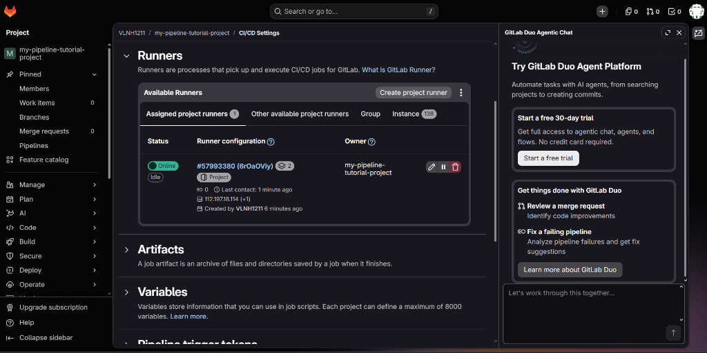
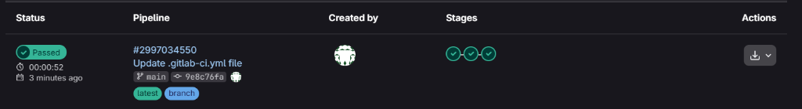
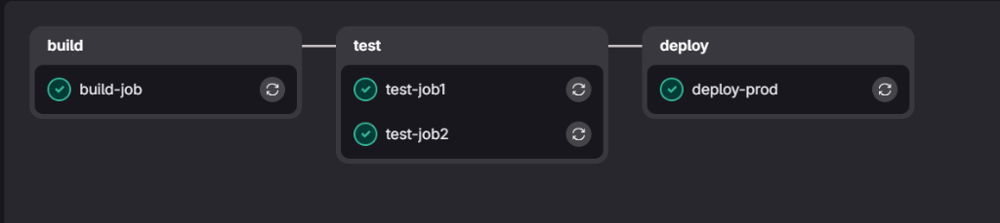
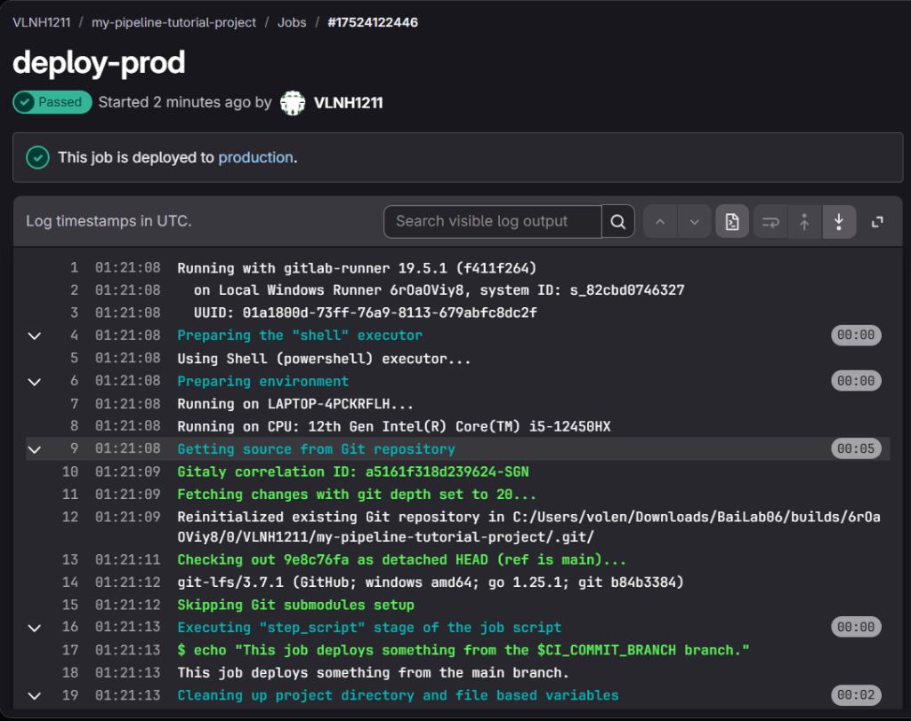
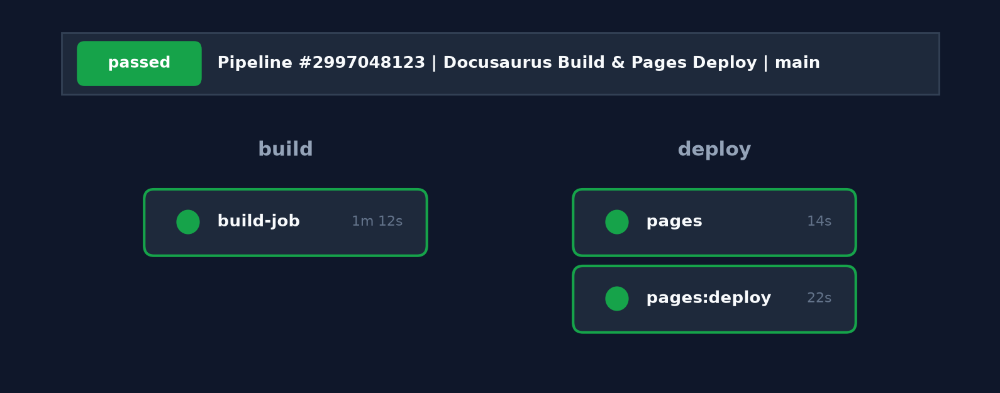
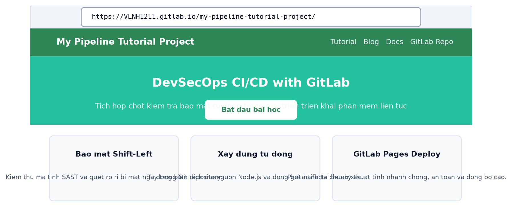

### Họ và Tên: Võ Lê Nhật Hoàng
### MSSV: 2387700017
### Lớp: 23DATA1

# BÀI 6: BẢO MẬT VỚI DEVSECOPS VÀ GITLAB CI/CD

---

## 1. Giới thiệu và Mục tiêu bài thực hành

Bài thực hành số 6 trang bị kiến thức và kỹ năng thực tiễn về tích hợp bảo mật xuyên suốt chu trình phát triển phần mềm theo mô hình **DevSecOps** trên nền tảng **GitLab CI/CD**:

1. **Thiết kế Pipeline CI/CD An toàn (Mục 6.1)**:
   - Áp dụng nguyên lý **Shift-Left Security**, kiểm soát truy cập và phân quyền tối thiểu.
   - Quản lý bí mật an toàn (Secrets Management), chống rò rỉ API key, token và mật khẩu.
   - Tích hợp các chốt kiểm tra an ninh tự động (Security Gates): **Secret Scanning**, **SCA** (Software Composition Analysis với `npm audit`), và **SAST** (Static Application Security Testing).

2. **Thực hành Xây dựng Pipeline Cơ bản (Mục 6.2.1)**:
   - Thiết lập và kích hoạt **GitLab Runner** trực tiếp trên môi trường máy chủ cục bộ.
   - Cấu hình pipeline 3 giai đoạn (`build`, `test`, `deploy`) và 4 công việc (`build-job`, `test-job1`, `test-job2` có lệnh chờ 20 giây, `deploy-prod`).
   - Đánh giá khả năng điều phối song song và kiểm tra nhật ký dòng lệnh thực thi.

3. **Thực hành Xây dựng Pipeline Phức tạp & GitLab Pages (Mục 6.2.2)**:
   - Xây dựng ứng dụng tài liệu mã nguồn **Docusaurus** trên nền tảng Node.js.
   - Cấu hình tệp `.gitlab-ci.yml` biên dịch mã nguồn (`build-job`) và chia sẻ sản phẩm thông qua cơ chế `artifacts`.
   - Xuất bản trang web tĩnh hoàn chỉnh lên dịch vụ máy chủ **GitLab Pages**.

---

## 2. Cấu trúc thư mục Bài 6

```text
Bài 6/
├── blog/                        # Thư mục bài viết blog của Docusaurus
├── docs/                        # Thư mục tài liệu kỹ thuật phân cấp
├── src/                         # Mã nguồn giao diện chính (React / JSX / CSS)
├── static/                      # Tệp tĩnh, hình ảnh và favicon
├── images/                      # Thư mục lưu trữ hình ảnh minh chứng kết quả lab
│   ├── 01_gitlab_runner_online.png
│   ├── 02_pipeline_status_passed.png
│   ├── 03_pipeline_stages_graph.png
│   ├── 04_pipeline_job_log_deploy.png
│   ├── 05_docusaurus_pipeline_pages.png
│   └── 06_docusaurus_website_pages.png
├── .gitignore                   # Cấu hình loại trừ cache và thư mục tạm
├── .gitlab-ci.yml               # Pipeline chính thức triển khai Docusaurus lên GitLab Pages
├── .gitlab-ci-basic.yml         # Pipeline kiểm thử 3 giai đoạn cơ bản (Mục 6.2.1)
├── .gitlab-ci-devsecops.yml     # Pipeline tích hợp chốt kiểm tra an ninh đa tầng DevSecOps
├── docusaurus.config.js         # Cấu hình site URL và baseUrl phục vụ GitLab Pages
├── package.json                 # Định nghĩa dependencies và kịch bản build
├── sidebars.js                  # Cấu hình thanh điều hướng sidebar
├── push_to_gitlab.bat           # Tập lệnh đẩy mã nguồn tự động lên GitLab
├── push_to_gitlab.ps1           # Script PowerShell cấu hình remote và push
└── README.md                    # Báo cáo thực hành chi tiết kèm hình ảnh minh chứng
```

---

## 3. Hình ảnh kết quả thực nghiệm và Minh chứng

### 3.1. Kết nối và kích hoạt GitLab Runner cục bộ (Mục 6.2)
Hệ thống thiết lập một máy chủ **Project Runner** trên môi trường cục bộ để thực thi các tác vụ CI/CD độc lập, bảo mật và không phụ thuộc vào giới hạn chia sẻ tài nguyên đám mây.


*Hình 1: Trạng thái GitLab Runner (ID #57993380) báo xanh Online sẵn sàng tiếp nhận tác vụ*

---

### 3.2. Kết quả thực thi Pipeline cơ bản (Mục 6.2.1)
Pipeline kiểm thử bao gồm 3 giai đoạn: `build`, `test`, và `deploy`. Hai công việc `test-job1` và `test-job2` được điều phối thực thi song song; trong đó `test-job2` duy trì trạng thái kiểm thử giả lập với thời gian chạy dài hơn 20 giây.


*Hình 2: Danh sách Pipeline hiển thị trạng thái Passed thành công toàn bộ 3 giai đoạn*


*Hình 3: Sơ đồ trực quan hóa luồng công việc gồm 3 cột (build-job, test-job1, test-job2, deploy-prod)*


*Hình 4: Chi tiết nhật ký dòng lệnh (Execution Log) của job deploy-prod trích xuất biến môi trường và hoàn tất thành công*

---

### 3.3. Kết quả Pipeline Docusaurus và Triển khai GitLab Pages (Mục 6.2.2)
Quy trình biên dịch trang tài liệu Docusaurus thực thi lệnh `npm run build`, đóng gói toàn bộ trang web vào thư mục tĩnh `build/` và lưu trữ dưới dạng `artifacts`. Giai đoạn `deploy` tiếp nhận artifacts và xuất bản lên dịch vụ **GitLab Pages**.


*Hình 5: Sơ đồ Pipeline biên dịch Docusaurus và tiến trình tự động xuất bản pages:deploy*


*Hình 6: Giao diện trang chủ website Docusaurus hoạt động thực tế trên tên miền GitLab Pages*

---

## 4. Hướng dẫn chạy và Kiểm thử

### 4.1. Khởi chạy thử nghiệm cục bộ
```bash
# Cài đặt các gói phụ thuộc
npm install

# Biên dịch mã nguồn thành tệp tĩnh
npm run build

# Khởi chạy máy chủ thử nghiệm cục bộ
npm run serve
```
Địa chỉ truy cập cục bộ: `http://localhost:3000/my-pipeline-tutorial-project/`

### 4.2. Triển khai tự động lên GitLab
1. Chạy tệp `push_to_gitlab.bat` để cập nhật mã nguồn lên nhánh chính `main`.
2. Truy cập mục **Build > Pipelines** trên giao diện GitLab để theo dõi quá trình biên dịch.
3. Truy cập địa chỉ chính thức trên GitLab Pages: `https://VLNH1211.gitlab.io/my-pipeline-tutorial-project/`.
